<p align="center">
  
</p>

# novatar

**Deterministic generative SVG avatars — one package, two engines, built for humans *and* AI agents.**

The same seed always produces the same avatar: byte-identical output across machines, runtimes, and replays.

- `npx novatar <seed>` — zero-config CLI exporting **SVG · PNG · WebP** stills and **animated SVG · APNG · GIF**
- `novatar-mcp` — MCP server for AI agents (Claude, Notion AI agents, Cursor, …)
- `novatar/server` — Web-standard HTTP handler (Vercel, Workers, Bun, Deno)
- `novatar/react` — React components (static + animated)
- Pure-JS/WASM encoders, no native builds required (WebP uses optional prebuilt sharp). No prompts. No network.

<p align="center"><strong>Optimized for AI agents</strong> — one deterministic toolchain every agent can drive via CLI, MCP, or HTTP.</p>

<table><tr>
<td align="center"><br /><sub><b>Claude</b></sub></td>
<td align="center"><picture><source media="(prefers-color-scheme: dark)" srcset="assets/agents/grok-white.svg" /></picture><br /><sub><b>Grok</b></sub></td>
<td align="center"><picture><source media="(prefers-color-scheme: dark)" srcset="assets/agents/openai-white.svg" />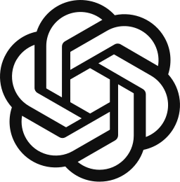</picture><br /><sub><b>OpenAI</b></sub></td>
<td align="center"><br /><sub><b>Gemini</b></sub></td>
</tr></table>

Two engines, one identity model:

| Engine       | Catalog                                                           |
| ------------ | ----------------------------------------------------------------- |
| `avatars`    | 21 variants · 4 families (gradient, fluid, classic, paletteless)  |
| `squishmoji` | 21 shapes × 22 expressions × 6 generative backgrounds             |

---

## Quick start (CLI)

```bash
npx novatar justin > justin.svg                          # SVG to stdout
npx novatar justin --engine squishmoji --shape cat --expression loving
npx novatar justin --engine avatars --variant triton --json
npx novatar justin --png --size 512 --out avatar.png     # still PNG
npx novatar justin --webp --quality 95 --out avatar.webp # still WebP
npx novatar justin --animate --out animated.svg          # animated SVG (SMIL, loops forever)
npx novatar justin --gif --size 256 --out avatar.gif     # animated GIF
npx novatar justin --apng --size 256 --out avatar.png    # animated PNG with alpha
npx novatar justin --gif --datauri                       # ready-to-embed data:image/gif URI
npx novatar --batch alice,bob,carol --apng --out 'team/{seed}.png'  # batch animations
npx novatar --random --count 12 --json                   # 12 random avatars as a JSON array
npx novatar --list                                        # machine-readable catalog
```

Read seeds from stdin — one per line; more than one line is a batch:

```bash
echo "user-42" | npx novatar - --json
git log --format=%an | sort -u | npx novatar - --png --out 'team/{seed}.png'
```

Full CLI reference: `npx novatar --help`. Agent-oriented cookbook: [AGENTS.md](./AGENTS.md).

## Install

```bash
npm install novatar
```

Works in Node ≥ 18, browser bundlers, Vercel Functions (Node & Edge for SVG), Cloudflare Workers, Bun, Deno.

---

## Programmatic API

### Unified — `createNovatar`

```ts
import { createNovatar } from 'novatar'

const svg = createNovatar({ seed: 'justin', engine: 'squishmoji', shape: 'cat', expression: 'loving' })

const json = createNovatar({ seed: 'justin', engine: 'avatars', variant: 'triton', format: 'json' })
// { seed, engine, svg, dataUri, variant, circle, effect, animate }
```

- `engine: 'auto'` (default) picks deterministically from the seed. Aliases: `squish`, `emoji`, `avatar`, `art`.
- Engine-specific options are ignored by the other engine, so one call shape covers both.

### Engine compat APIs

The full upstream surfaces are preserved for drop-in migration:

```ts
import { createAvatar, resolveVariant } from 'novatar'            // @usespaceui/avatars API
import { createSquishmoji, resolveLayout, renderLayout, SquishEngine } from 'novatar' // @usespaceui/squishmoji API
```

### Introspection & palettes

```ts
import { listNovatarStyles, generatePalette } from 'novatar'

listNovatarStyles()        // { engines: [{ id, variants | shapes, expressions, backgrounds }] }
listNovatarStyles('squishmoji')
generatePalette('justin')  // { seed, colors: [ '#..', ×5 ] } — bit-exact with @usespaceui/gradients
```

### Raster, WebP & animation exports

```ts
import { renderPng, renderPngDataUri, renderWebp } from 'novatar/raster'
import { renderAnimatedSvg, renderAnimatedGif, renderAnimatedApng } from 'novatar'

const png = await renderPng(svg, { width: 512 })                  // Uint8Array (resvg WASM)
const webp = await renderWebp(svg, { width: 512, quality: 95 })   // optional sharp
const animatedSvg = renderAnimatedSvg({ seed: 'justin', shape: 'cat' }) // SMIL, loops forever
const gif = await renderAnimatedGif({ seed: 'justin', width: 256, fps: 12 })
const apng = await renderAnimatedApng({ seed: 'justin', width: 256 })    // full alpha
```

Animated exports reproduce the `<Squishmoji />` motion (autonomous blinking
+ gaze drift, optional `wobble`) from one frame solver, so every format
moves identically. Loops are locked to the 4.7 s blink cycle — `duration` is
snapped to a multiple of it so GIF/APNG wraps are seamless. GIF composites
transparency onto a `gifBackground` matte (1-bit alpha); APNG and animated
SVG keep full alpha. Animated raster exports use the squishmoji engine
(the avatars engine's CSS animation cannot be time-sampled by rasterizers).

---

## React

```tsx
import { Novatar, Avatar, Squishmoji } from 'novatar/react'

<Novatar seed="justin" engine="squishmoji" shape="cat" size={64} />
<Avatar name="orion" variant={/* 'triton' | family | 'all' */ 'fluid'} animate />
<Squishmoji seed="justin" shape="cat" expression="loving" animate animOnClick animOnHover />
```

`<Squishmoji />` is the fully alive experience: breathing, gaze drift, blinks,
hover/click reactions, reduced-motion aware. `<Avatar />` and `<Novatar />` render
static markup (SSR-safe). React 18+ is an optional peer dependency — the core
never imports it.

---

## HTTP API (Vercel & friends)

```ts
// app/api/avatar/[[...route]]/route.ts
import { createNovatarHandler } from 'novatar/server'

export const GET = createNovatarHandler({ base: '/api/avatar' })
```

```html


```

Deterministic responses ship with `Cache-Control: immutable`. See
[examples/vercel-api](./examples/vercel-api) for a deployable project.

---

## Astro

First-class — and no React required. The core generates plain SVG strings, so
avatars render at build time with **zero client-side JavaScript** (even the
animated SVG blinks via SMIL, no hydration):

```astro
---
import { createNovatar, renderAnimatedSvg } from 'novatar'
const avatar = createNovatar({ seed: 'justin', engine: 'squishmoji', shape: 'cat', expression: 'loving' })
const animated = renderAnimatedSvg({ seed: 'hero', shape: 'ufo' })
---
<Fragment set:html={avatar} />
<Fragment set:html={animated} />
```

The HTTP handler drops into an Astro endpoint as a Web-standard
`Request → Response` function (all formats: svg / png / webp / gif / apng /
json, plus `?animate=true`):

```ts
// src/pages/api/avatar/[...route].ts
import type { APIRoute } from 'astro'
import { createNovatarHandler } from 'novatar/server'

export const prerender = false // on-demand route (Astro is static by default)
const handler = createNovatarHandler({ base: '/api/avatar' })
export const GET: APIRoute = (ctx) => handler(ctx.request)
```

`astro dev` serves the endpoint as-is; `astro build` needs any adapter (e.g.
`@astrojs/node`) for on-demand routes. The React components from
`novatar/react` also work through `@astrojs/react` when you want interactive
islands (`<Squishmoji client:load />`). Complete working project:
[examples/astro](./examples/astro).

---

## Style catalog

<!-- novatar:gallery:start -->
### avatars engine — 21 variants

All tiles use the same seed (`orion`), so palette differences come from the variants themselves.

<h4>gradient</h4>

<table><tr>
<td align="center">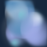<br /><sub><code>lumina</code></sub></td>
<td align="center">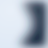<br /><sub><code>shaula</code></sub></td>
<td align="center"><br /><sub><code>singularity</code></sub></td>
<td align="center">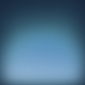<br /><sub><code>triton</code></sub></td>
<td align="center">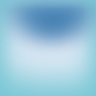<br /><sub><code>solar-flare</code></sub></td>
<td align="center">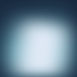<br /><sub><code>titan</code></sub></td>
<td align="center">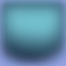<br /><sub><code>glass</code></sub></td>
</tr></table>

<h4>fluid</h4>

<table><tr>
<td align="center"><br /><sub><code>splash</code></sub></td>
<td align="center"><br /><sub><code>animals</code></sub></td>
<td align="center"><br /><sub><code>astronaut</code></sub></td>
<td align="center"><br /><sub><code>ghost</code></sub></td>
<td align="center"><br /><sub><code>bot</code></sub></td>
<td align="center">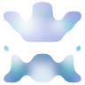<br /><sub><code>glitch</code></sub></td>
</tr></table>

<h4>classic</h4>

<table><tr>
<td align="center"><br /><sub><code>pebble</code></sub></td>
<td align="center">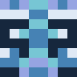<br /><sub><code>invader</code></sub></td>
<td align="center">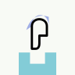<br /><sub><code>grunge</code></sub></td>
<td align="center">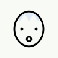<br /><sub><code>bored</code></sub></td>
<td align="center"><br /><sub><code>doodle</code></sub></td>
<td align="center">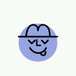<br /><sub><code>squiggle</code></sub></td>
</tr></table>

<h4>paletteless</h4>

<table><tr>
<td align="center">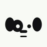<br /><sub><code>critter</code> <i>(ink-only)</i></sub></td>
<td align="center"><br /><sub><code>kendo</code> <i>(ink-only)</i></sub></td>
</tr></table>

### squishmoji engine — 21 shapes

Seed `novatar`, rotating expressions to show a little life:

<table><tr>
<td align="center"><br /><sub><code>circle</code></sub></td>
<td align="center"><br /><sub><code>pebble</code></sub></td>
<td align="center"><br /><sub><code>squircle</code></sub></td>
<td align="center"><br /><sub><code>capsule</code></sub></td>
<td align="center"><br /><sub><code>triangle</code></sub></td>
<td align="center">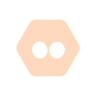<br /><sub><code>hexagon</code></sub></td>
<td align="center">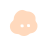<br /><sub><code>cloud</code></sub></td>
</tr></table>

<table><tr>
<td align="center">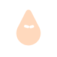<br /><sub><code>drop</code></sub></td>
<td align="center"><br /><sub><code>square</code></sub></td>
<td align="center">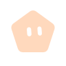<br /><sub><code>pentagon</code></sub></td>
<td align="center"><br /><sub><code>octagon</code></sub></td>
<td align="center">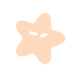<br /><sub><code>star</code></sub></td>
<td align="center">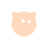<br /><sub><code>cat</code></sub></td>
<td align="center"><br /><sub><code>ghost</code></sub></td>
</tr></table>

<table><tr>
<td align="center"><br /><sub><code>ufo</code></sub></td>
<td align="center"><br /><sub><code>flower</code></sub></td>
<td align="center">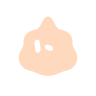<br /><sub><code>bot</code></sub></td>
<td align="center">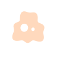<br /><sub><code>alien</code></sub></td>
<td align="center">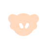<br /><sub><code>lion</code></sub></td>
<td align="center">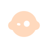<br /><sub><code>monkey</code></sub></td>
<td align="center">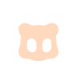<br /><sub><code>mecha</code></sub></td>
</tr></table>

### 22 expressions

Same seed and shape — only the expression changes:

<table><tr>
<td align="center"><br /><sub><code>neutral</code></sub></td>
<td align="center"><br /><sub><code>attentive</code></sub></td>
<td align="center"><br /><sub><code>surprised</code></sub></td>
<td align="center"><br /><sub><code>excited</code></sub></td>
<td align="center"><br /><sub><code>happy</code></sub></td>
<td align="center"><br /><sub><code>laughing</code></sub></td>
<td align="center"><br /><sub><code>angry</code></sub></td>
<td align="center"><br /><sub><code>sad</code></sub></td>
</tr></table>

<table><tr>
<td align="center"><br /><sub><code>scared</code></sub></td>
<td align="center"><br /><sub><code>suspicious</code></sub></td>
<td align="center"><br /><sub><code>confused</code></sub></td>
<td align="center"><br /><sub><code>curious</code></sub></td>
<td align="center"><br /><sub><code>proud</code></sub></td>
<td align="center"><br /><sub><code>shy</code></sub></td>
<td align="center"><br /><sub><code>bored</code></sub></td>
<td align="center"><br /><sub><code>sleepy</code></sub></td>
</tr></table>

<table><tr>
<td align="center"><br /><sub><code>crazy</code></sub></td>
<td align="center"><br /><sub><code>loving</code></sub></td>
<td align="center"><br /><sub><code>determined</code></sub></td>
<td align="center"><br /><sub><code>guilty</code></sub></td>
<td align="center"><br /><sub><code>amazed</code></sub></td>
<td align="center"><br /><sub><code>doubtful</code></sub></td>
</tr></table>

### 6 generative backgrounds

<table><tr>
<td align="center"><br /><sub><code>solid</code></sub></td>
<td align="center">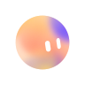<br /><sub><code>taygeta</code></sub></td>
<td align="center">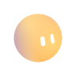<br /><sub><code>maia</code></sub></td>
<td align="center">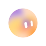<br /><sub><code>merope</code></sub></td>
<td align="center"><br /><sub><code>celaeno</code></sub></td>
<td align="center"><br /><sub><code>alcyone</code></sub></td>
</tr></table>
<!-- novatar:gallery:end -->

Every catalog accepts `all` for a deterministic pick from the seed. Query the live
catalog anywhere: `npx novatar --list` or `listNovatarStyles()`.

---

## MCP server (AI agents)

Expose novatar to any MCP client — three tools: `novatar_generate`,
`novatar_list_styles`, `novatar_palette`.

```jsonc
// e.g. Claude Desktop: claude_desktop_config.json
{
  "mcpServers": {
    "novatar": { "command": "npx", "args": ["-y", "novatar", "--mcp"] }
  }
}
```

Any stdio MCP client works: `novatar-mcp` is also a standalone bin. Setup recipes
for Notion AI agents and sandbox environments: [AGENTS.md](./AGENTS.md).

---

## Determinism & versioning

- Same seed + same options → byte-identical SVG/PNG, on every machine, forever within a major version.
- Output parity with upstream `@usespaceui/avatars@0.1.x` / `@usespaceui/squishmoji@0.1.x` / `@usespaceui/gradients@0.1.x` is enforced by the contract tests (`npm test`).
- Breaking visual changes will bump the major version.

## Development

```bash
npm install
npm run build      # tsup → dist (esm + cjs + types)
npm test           # contract tests: engines, upstream parity, CLI, MCP, HTTP
```

## Credits & license

[MIT](./LICENSE) © 2026 Justin Cheu.

novatar merges and extends two MIT-licensed engines by
[SpaceUI](https://github.com/usespaceui), with bit-exact output parity verified
by the test suite:

| Engine       | Ported from                                                                                     | Catalog                                                    |
| ------------ | ----------------------------------------------------------------------------------------------- | ---------------------------------------------------------- |
| `avatars`    | [`@usespaceui/avatars`](https://github.com/usespaceui/avatars)                                   | 21 variants · 4 families (gradient, fluid, classic, paletteless) |
| `squishmoji` | [`@usespaceui/squishmoji`](https://github.com/usespaceui/squishmoji)                             | 21 shapes × 22 expressions × 6 generative backgrounds      |

Palette data is vendored from
[@usespaceui/gradients](https://www.npmjs.com/package/@usespaceui/gradients)
(MIT, SpaceUI). PNG rasterization by
[resvg-wasm](https://github.com/thx/resvg-js). Agent logos from
[thesvg.org](https://thesvg.org); all trademarks belong to their owners.
